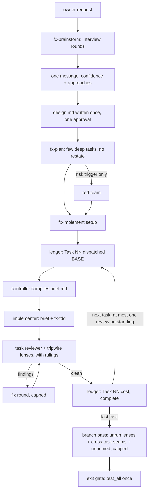

# fx lean pipeline: fewer reads, fewer stops, fewer chains

**Date:** 2026-10-21
**Status:** ready-for-agent
**Glossary:** no CONTEXT.md exists; terms are those of `01-current.md`'s glossary. One term is added: **brief**, the single file a controller compiles for one implementer dispatch.

## Problem Statement

The owner runs brainstorm, then plan, then implement, and it takes far too long and spends far too many tokens. Measured: a six-task fixture build takes 33 to 56 minutes and 18 to 29M tokens; real 5 to 13-task plans span 25 to 70 hours of git time; subagents spend 75% of all tokens and 89% of all turns, almost all of it re-reading context (99.4% cache reads). Before any code is written, the owner answers about R+11 stops, and sees the design twice (`03-gaps.md` rows "Target", 45, 46, 48, 13, 20).

## Solution

The owner keeps the same lanes and the same quality floor, but each step reads less and stops less:

- An implementer gets one compiled brief instead of assembling 55 to 70 KB from five places.
- Lane files carry rules, not incident stories.
- A plan has fewer, deeper tasks that describe behaviour and name their tests, so there are fewer implement-review-fix chains.
- Brainstorm writes design.md once and asks for one approval; plan does not re-confirm it.
- The final branch review covers only what per-task review did not, on models chosen by one router.
- Every task ends with a measured cost line, so each of these changes is proved on a real build.

## User Stories

1. As the owner, I want a brainstorm to reach an approved design.md in R+3 stops, so that I spend my time answering real questions, not approving the same content twice.
2. As the owner, I want the confidence check and the approaches in one message, so that one reply moves the design forward.
3. As the owner, I want to review the design once, as the file, so that what I approve is what the planner reads.
4. As the owner, I want fx-plan to skip restating requirements when I approved the design in this session, so that I am not asked the same thing again.
5. As the owner, I want a plan to have as few tasks as its seams need, so that the build runs fewer agent chains.
6. As the owner, I want task files that state behaviour and name tests, so that plans are smaller and no unrun test code is copied into them.
7. As the owner, I want the red-team offered on risk, not on task count, so that it runs when it can change the outcome.
8. As a controller, I want to compile one brief per task from the task, the rulings that apply, the design excerpt it cites and the stack slice, so that the implementer reads one file.
9. As an implementer, I want TDD rules in exactly one place (fx-tdd), so that I read them once.
10. As an implementer, I want my prompt to carry my role and reply contract only, so that my context starts small.
11. As a maintainer, I want each lane's incident stories kept in that lane's COVERAGE.md, so that the evidence survives without being loaded.
12. As a task reviewer, I want the rulings for my task handed to me, so that I never read the whole ledger.
13. As the owner, I want the branch pass capped and limited to lenses that did not run per task plus cross-task seams, so that the end of a build does not re-review the whole branch.
14. As the owner, I want every model choice to go through one router, so that no agent definition silently runs on the most capable tier.
15. As the owner, I want a cost line per task (tokens, minutes, dispatches), so that I can see where a build's time went.
16. As a controller resuming after compaction, I want a dispatch line per task in the ledger, so that I never re-dispatch work already committed.
17. As a controller, I want a cap on reviews outstanding while implementers advance, so that a Critical finding lands while its task is still current.
18. As a controller, I want a cap on NEEDS_CONTEXT and BLOCKED re-dispatches, so that an impossible task stops the line once, not forever.
19. As a maintainer, I want gate tests to pin the brief's size ceiling and the stop order, so that the savings cannot creep back.

## Implementation Decisions

**1. Compile one brief per implementer dispatch** (candidate 1; rows 29, 46, 48).
- fx-implement's controller writes a brief per task into the ephemeral `.fx/<slug>/` area: the task file's behaviour and test names, the `Ruling:` lines that name the task or the whole plan, the design.md passages the task cites (not the whole design), and the stack section the task's files touch.
- The implementer template shrinks to role, workspace, the brief path, the reply contract and the status vocabulary. Its TDD summary is deleted; fx-tdd is the sole owner of TDD rules.
- good-tests.md stays a reference fx-tdd loads, but only its rules, not its worked examples (those move with candidate 2).
- A gate test pins a byte ceiling on the template and on a fixture brief.

**2. Move case histories out of the loaded lane text** (candidate 2; row 29, 01-current "Incident prose").
- Each "Measured:" story in fx-implement's templates, fx-implement SKILL, fx-plan SKILL and fx-tdd becomes one line of rule plus at most one line of why. The story moves to that lane's COVERAGE.md, which no session loads.
- Applies first to the files every build loads: implementer template, task-reviewer template, fx-implement, fx-plan, fx-tdd.

**3. Plan fewer, deeper tasks** (candidate 3; rows 21, 22, 23, 24, 49, 50).
- A task states behaviour, the confirmed seam, and the names and assertions of its tests in prose. Test code is written by the implementer through fx-tdd against real code. Verbatim snippets stay only for decision-rich shapes (schemas, state machines), as today's exception allows.
- Right-sizing: a task is one seam. Docs, ADR, rename and config work fold into the task that needs them. Tasks that edit the same files merge.
- Task template fields Idempotency, Risks and Interfaces become optional, present only when not the default.
- "Similar to task N: repeat it" is replaced by "name the shared rule once in plan.md"; the brief (decision 1) carries it into each task.
- Red-team triggers drop "10+ tasks"; the risk triggers stay.

**4. Merge the brainstorm and plan gates into one design checkpoint** (candidate 4; rows 12, 13, 14, 15, 20). Supersedes ADR 0033 (pre-production: edit in place, new ADR records the change).
- Architectural path: interview rounds, then one message with the confidence statement and the 2 to 3 approaches, then brainstorm writes design.md section by section in the file and asks for one approval of the file, seams included.
- The user-story list is "complete for the feature's behaviour", not "extremely extensive".
- The checklist no longer creates one task-tool item per step.
- fx-plan skips its restate step when the design's Status shows it was approved in this session, and keeps its handoff menu.
- Bounded and spike paths are unchanged.

**5. Let the branch pass review only what per-task review did not** (candidate 5; rows 32, 35, 39, 40). Supersedes ADR 0029's "every lens at the branch pass".
- `route()` owns every model choice, `fx:` agents included; the two frontmatter opus pins are removed and the security lens and devil's advocate get the most capable tier only through a `Capable because:` line the controller writes.
- The branch pass dispatches: lenses whose tripwire never fired in any task, one pass over cross-task seams, and the unprimed devil's advocate. A hard cap on agents per branch pass lives in the lane and is checked by a gate test.
- The task reviewer receives the applicable `Ruling:` lines in its dispatch (the same extraction the brief uses) and is no longer given the ledger path.

**6. Write a cost line to the ledger for every task** (candidate 6; row 44), plus the three pipeline-lens findings that share the ledger.
- At each task's end the controller runs build-cost over the session transcript and appends `Task NN: cost <tokens> <minutes> <dispatches>`.
- At dispatch the controller appends `Task NN: dispatched <BASE>`; resume checks for that line and the task's commits before re-dispatching (lens finding 3).
- At most one task review outstanding while the next implementer runs; the next dispatch waits for it (lens finding 1).
- NEEDS_CONTEXT and BLOCKED: two re-dispatches per task, then the task is parked with a ruling and the owner is told (lens finding 2).

Order of landing: 6 first (so every later change is measured), then 2, 1, 3, 5, 4.

## Testing Decisions

- **Seams:** the lane files and templates are tested where fx already tests them: the gates suite (`tests/gates/*.test.js`), the lane-triggering prompts, the review bench, and the six-task fixture build measured by build-cost. route() is tested at `lib/dispatch-route.js`'s own test.
- **Good tests here** assert observable output: a gate fails if a template or fixture brief exceeds its byte ceiling, if the brainstorm stop order changes, if the branch pass names more agents than its cap, if an `fx:` agent dispatch without `Capable because:` is not routed to the standard tier.
- **Quality floor:** the review bench must still catch at least 23 of 24 planted defects, and lane-triggering must stay 17 of 17 (today's results).
- **Speed proof:** three fixture builds before and after each landed candidate, read by build-cost; report the median against today's medians (41.5 minutes, 23.3M tokens, the shipped "combined" configuration).
- **Prior art:** docs/plans/2026-09-23-lean-build/measurements.md (fixture builds and bench), tests/review-bench/, tests/lane-triggering/.

## Global Constraints

- No em dashes or en dashes in any lane text.
- Pre-production: no compatibility shims; edit in place and supersede ADRs.
- Every decision above gets an ADR, numbered from 0040 on.
- Review bench at least 23 of 24; lane-triggering 17 of 17; conformance 0 fail.
- Preamble stays under 3,000 characters.
- Model routing default stays the standard tier.

## Out of Scope

- Parallel implementers (measured at 6% gain and dropped; shared test database).
- The preamble's 1% rule and the hook layer (about 800 tokens and 18 ms; not where the cost is).
- The four harness front ends' duplication (change cost, not run cost).
- fx's own maintainer gates (check-all, test-scope).
- fx-design's missing handoff (row 19) and the brainstorm-to-design ordering (row 17): real, low impact, a later design.

## Open Questions

None. The owner chose all six candidates at the Phase 3 gate.

## Further Notes

The size of the brief and the R+3 stop count are targets, not measurements; decision 6 lands first so both are measured on real builds.

## Proposed folder tree

```
fx/
  skills/fx-implement/   brief compilation step; implementer template cut to role + contract; cost and dispatch ledger lines; review and re-dispatch caps
  skills/fx-tdd/         sole owner of TDD rules; incident stories move to COVERAGE.md
  skills/fx-plan/        deeper-task template, optional fields, risk-only red-team trigger, restate skip
  skills/fx-brainstorm/  merged confidence + approaches message, one design.md approval
  skills/fx-review/      branch pass limited and capped
  skills/*/COVERAGE.md   receive the moved incident stories
  agents/                frontmatter model pins removed
  codex/                 regenerated from agents/
  references/            design-template user-story wording; good-tests rules only
  lib/                   dispatch-route covers fx: agents; plan-state exports ruling extraction for briefs
  scripts/               build-cost gains a per-task mode
  tests/gates/           size ceilings, stop order, branch cap, routing of fx: agents
  docs/adr/              0040 onward for each decision; 0029 and 0033 superseded
```

## Core interface signatures

- `lib/plan-state.js`: `rulingsFor(planDir, taskId) -> string[]` returns the `Ruling:` lines naming that task or the whole plan, from the plan ledger and `docs/plans/rulings.md`.
- `lib/dispatch-route.js`: `route(toolInput) -> toolInput | null`, now also applied to `fx:` subagent types.
- `scripts/build-cost`: `build-cost --task <NN> --since <ISO time> <transcript> -> "Task NN: cost <tokens> <minutes> <dispatches>"`.
- fx-implement brief (file contract): `brief.md` with sections `Task`, `Rulings`, `Design excerpt`, `Stack`, `Reply contract`.
- fx-review branch pass (lane contract): `branch(passes: lensesNotRunPerTask ∪ {crossTaskSeams, unprimed}, cap: N)`.

## Lifecycle diagram



## Per-module verdict

**Module count:** 13 modules listed in the **Modules** field of `01-current.md`'s patterns and file structure section. **Row count:** 13 rows below.

| Module | Verdict | Reason |
|---|---|---|
| skills/ | refactor | Lane text is where the tokens are read: implementer template, fx-tdd, fx-plan, fx-brainstorm, fx-review change (skills/fx-implement/implementer-prompt.md:47) |
| agents/ | refactor | Remove the two opus pins so route() decides (agents/fx-lens-security.md:15) |
| codex/ | keep | Regenerated from agents/ by its generator, no hand edits (scripts/gen-codex-agents:13) |
| commands/ | keep | User-invoked lanes, not on the slow path (commands/fx-grill.md:3) |
| references/ | refactor | User-story wording and good-tests trimmed to rules (references/design-template.md:35) |
| hooks/ | keep | About 18 ms per call, not the cost (hooks/hooks.json:30) |
| lib/ | refactor | route() covers fx: agents; plan-state gains ruling extraction (lib/dispatch-route.js:20) |
| plugins/ | keep | opencode front ends follow the lane text (plugins/fx-opencode-v2.js:192) |
| scripts/ | refactor | build-cost gains its first caller and a per-task mode (scripts/build-cost:5) |
| tests/ | refactor | New gates for size ceilings, stop order, branch cap (scripts/test-scope:45) |
| docs/ | refactor | ADRs 0040 onward; 0029 and 0033 superseded (docs/plans/2026-09-29-lean-review/design.md:22) |
| tasks/ | keep | Maintainer notes, never loaded (tasks/lessons.md:3) |
| root files | keep | Preamble already small and capped (PREAMBLE.md:15) |

## Add-a-new-provider walkthrough

In fx the extension point on the slow path is a new stack or harness feeding the brief. Adding a stack (say `go`) after this design:

1. `references/stacks/go.md`: write the stack file with one section per file kind; the brief compiler takes only the section the task's files touch.
2. The repo's `.fx.json`: add `go` to `stacks`.
3. fx-implement's brief step: no change; it selects stack sections by the task's file list.
4. `tests/gates/`: the brief size gate runs on a fixture brief that includes a `go` slice.

No lane template, no route() and no hook changes. A new harness adds its `references/harnesses/<name>.md` and an ADDRESSING entry in `lib/preamble.js`, as today.

## Recommendation

Incremental refactor. Every high-impact row in `03-gaps.md` (29, 21, 22, 24, 13, 32, 35, 49, 50) sits in lane text, templates and two small library functions; the hooks, the preamble, the routing default and the reply contracts are rated correct and stay. The six candidates change what each agent reads and how many agents and stops a run has, without changing the lane structure fx already tests. Land the cost line first, then measure each change on the fixture build.

## Defeater

A rewrite of the pipeline (for example one long-running implementer per plan instead of a chain per task) wins if, after decisions 6, 2, 1 and 3 have landed, three six-task fixture builds measured by build-cost do not cut median total tokens by at least 30% from today's 23.3M median, or median wall clock by at least 25% from 41.5 minutes. Then the cost lives in the per-task chain shape itself, not in what each agent reads, and trimming text cannot reach the target.
